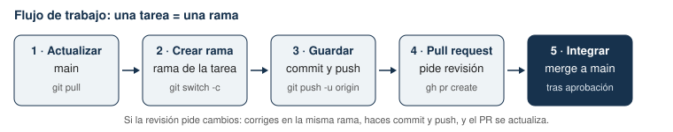
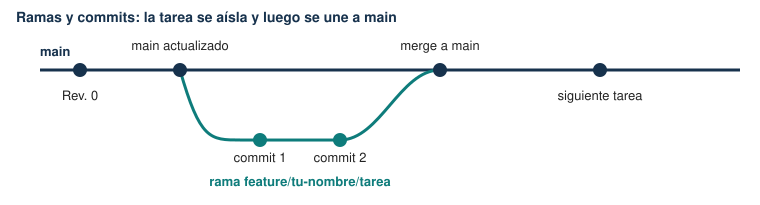
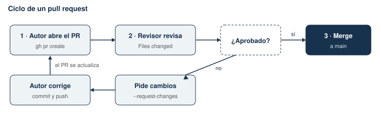
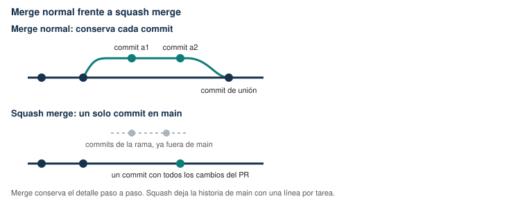
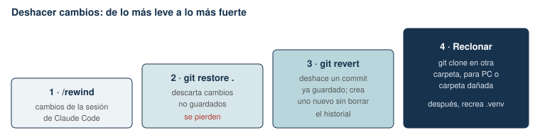

# Manual de uso de GitHub con diagramas

## 1. Conceptos básicos

- **Git:** programa en tu PC que guarda el historial de cambios de tu proyecto. Cada versión guardada se llama **commit**.
- **GitHub:** sitio web que guarda una copia de tu repositorio en la nube. Sirve de respaldo y de lugar para revisar cambios.
- **Repositorio (repo):** la carpeta del proyecto junto con todo su historial.
- **Rama (branch):** línea de trabajo separada. Cada tarea se trabaja en su propia rama, sin tocar la versión principal.
- **main:** rama principal, la versión oficial del proyecto.
- **Pull request (PR):** propuesta formal para integrar una rama a main. Permite revisar los cambios antes de aceptarlos.
- **Revisión (review):** comentarios o aprobación de otra persona sobre un PR.
- **Merge:** integra la rama aprobada a main.
- **Squash merge:** integra todos los commits del PR como uno solo en main.
- **.gitignore:** lista de archivos que Git no debe guardar.

## 2. Flujo de trabajo completo



Cada tarea sigue estos cinco pasos. El paso 5 solo ocurre cuando alguien aprueba el PR.

## 3. Preparación inicial (una sola vez)

**Instalar Git y GitHub CLI:**

```
winget install --id Git.Git --exact
winget install --id GitHub.cli --exact
```

Cierra y abre PowerShell. Configura tu identidad (usa el correo de tu cuenta de GitHub):

```
git config --global user.name "TU NOMBRE"
git config --global user.email "TU CORREO"
git config --global init.defaultBranch main
```

Inicia sesión con la ventana del navegador. Nunca escribas tu contraseña en la terminal:

```
gh auth login --hostname github.com --git-protocol https --web
```

Descarga el proyecto si todavía no tienes una copia:

```
cd C:\
git clone https://github.com/delarosaclr2-cmd/ENGICALC.git
```

**Verificación:** `git --version` y `gh --version` deben responder con un número de versión.

## 4. Ramas y commits



La rama de la tarea parte de main actualizado. Sus commits no tocan main hasta el merge. Por eso puedes equivocarte en tu rama sin afectar a los demás.

## 5. Guardar, subir y actualizar

Después de editar, ejecuta las pruebas y revisa qué vas a incluir:

```
git status --short
git diff
git add RUTA_DEL_ARCHIVO
git diff --cached
git commit -m "feat: agregar calculadora HVAC"
git push -u origin feature/tu-nombre/calculadora-hvac
```

- **git add:** elige qué archivos entran en el commit. Repite el comando por cada archivo.
- **git commit:** guarda una versión en tu PC con un mensaje claro.
- **git push:** sube tus commits a GitHub. En los envíos siguientes basta con `git push`.
- **git pull:** baja a tu PC los cambios de GitHub. Usa `git pull --ff-only` para evitar fusiones inesperadas.

Regla de mensajes de commit: un prefijo y una frase corta, por ejemplo `feat:` para funcionalidad, `fix:` para errores, `docs:` para documentación.

## 6. Pull request y revisión

El PR es la propuesta de integrar tu rama a main. Crear el PR todavía no integra nada. Pasos:

```
gh pr create --base main --reviewer USUARIO_REVISOR
```



En GitHub, la pestaña **Files changed** muestra línea por línea qué cambió. Para comentar una línea: **+ azul > Start a review > Submit review**. El revisor elige una sola acción:

```
gh pr review NUMERO_PR --request-changes --body "Problema, pasos y resultado esperado."
gh pr review NUMERO_PR --approve --body "Commit revisado y pruebas comprobadas."
```

## 7. Merge y squash merge

Cuando el PR está aprobado, se integra a main. Hay dos formas principales:



- **Merge normal (`--merge`):** conserva cada commit de la rama y agrega uno de unión. Es el valor que usa este manual.
- **Squash merge (`--squash`):** junta los commits del PR en uno solo. Mantiene main más legible; pierdes el detalle paso a paso.

```
gh pr merge NUMERO_PR --merge --match-head-commit SHA_REVISADO
gh pr merge NUMERO_PR --squash --match-head-commit SHA_REVISADO
```

`--match-head-commit` obliga a integrar solo el commit que se revisó. Sustituye `SHA_REVISADO` por el identificador completo. Después confirma que el PR muestre **Merged** y actualiza tu copia local con `git switch main` y `git pull --ff-only origin main`.

## 8. Deshacer cambios

Empieza siempre por la opción más leve. Cada escalón altera más el proyecto.



1. **Claude hizo algo mal en la sesión:** presiona Esc dos veces o escribe `/rewind`. Los checkpoints pueden no cubrir cambios hechos por comandos de terminal; para eso está Git.
2. **Descartar todo lo no guardado:** `git restore .`. Revisa antes con `git status`, porque lo descartado no se recupera.
3. **Revertir un commit malo:** `git log --oneline` para ubicar el código y después `git revert CODIGO_DEL_COMMIT`.
4. **Daño en la PC o en la carpeta:** `git clone` en otra carpeta y vuelve a crear el entorno virtual.

## 9. Archivo .gitignore

El archivo `.gitignore`, en la raíz del proyecto, indica qué no debe guardar Git. Créalo antes del primer commit:

| Línea | Qué es | Por qué no se guarda |
| --- | --- | --- |
| `.venv/` | Librerías instaladas | Son miles de archivos y se reconstruyen con `requirements.txt` |
| `__pycache__/`, `*.pyc` | Copias temporales de Python | Python las regenera al ejecutar |
| `.pytest_cache/` | Memoria temporal de pytest | Se regenera al correr las pruebas |
| `salidas/` | Esquemas y PDF generados | Salen del código y los datos |
| `.vscode/`, `.idea/` | Configuración del editor | Son preferencias personales |
| `Thumbs.db` | Miniaturas de Windows | No pertenece al proyecto |

Si un archivo ya fue guardado en un commit, agregarlo al `.gitignore` no lo saca del historial. Para quitarlo sin borrarlo de tu PC: `git rm -r --cached RUTA`.

Para saber qué línea excluye un archivo: `git check-ignore -v NOMBRE_DEL_ARCHIVO`.

## 10. Problemas comunes

| Lo que ves | Causa probable | Qué hacer |
| --- | --- | --- |
| `claude` no se reconoce | La terminal se abrió antes de instalarlo | Cierra y abre la terminal; si sigue, reinstala Claude Code |
| `python` abre la Microsoft Store | Python no está instalado o no está en el PATH | Instálalo desde python.org marcando "Add python.exe to PATH" |
| Ejecución de scripts deshabilitada | Política de seguridad de PowerShell | Consulta antes de cambiar la política de ejecución |
| `ModuleNotFoundError` | El entorno virtual no está activo | Activa `.venv`; si sigue, `python -m pip install NOMBRE` |
| `fatal: not a git repository` | Estás en otra carpeta | Revisa que la ruta sea `C:\ENGICALC` |
| `git push` rechazado (`Updates were rejected`) | GitHub tiene cambios que tu copia no tiene | `git pull --ff-only` y luego `git push`; si falla, detente |
| `git diff` o `git log` no responde | Espera que leas | Presiona `q` para salir |
| Cambios en archivos no previstos | La instrucción fue amplia | Revisa con `git status`, usa `/rewind` y precisa la instrucción |
| Una prueba pasa al cambiar un valor esperado | Se modificó `tests/` o `casos_referencia/` | Rechaza el cambio; esos valores solo se cambian con una fuente validada |
| Se pierde el contexto acordado | La sesión es muy larga | Usa `/clear` y pide que lea `BITACORA.md` |
| Aviso de límite de uso | Se alcanzó el límite del plan | Revisa `/usage` o cambia de modelo |

## 11. Reglas de seguridad

- Nunca escribas contraseñas, claves ni tokens en la terminal ni en archivos. Inicia sesión con la ventana del navegador.
- No guardes datos personales ni de clientes en el repositorio.
- Revisa con `git diff` los cambios en `tests/` y `casos_referencia/` antes de cada commit.
- Mantén el repositorio privado mientras contenga trabajo de RMR.
- Ante un error: detente, conserva el mensaje completo y pide revisión. No fuerces operaciones (`--force`) ni borres cambios para resolverlo.
